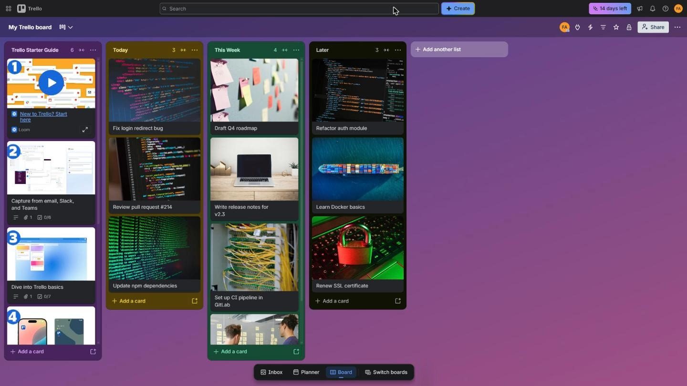
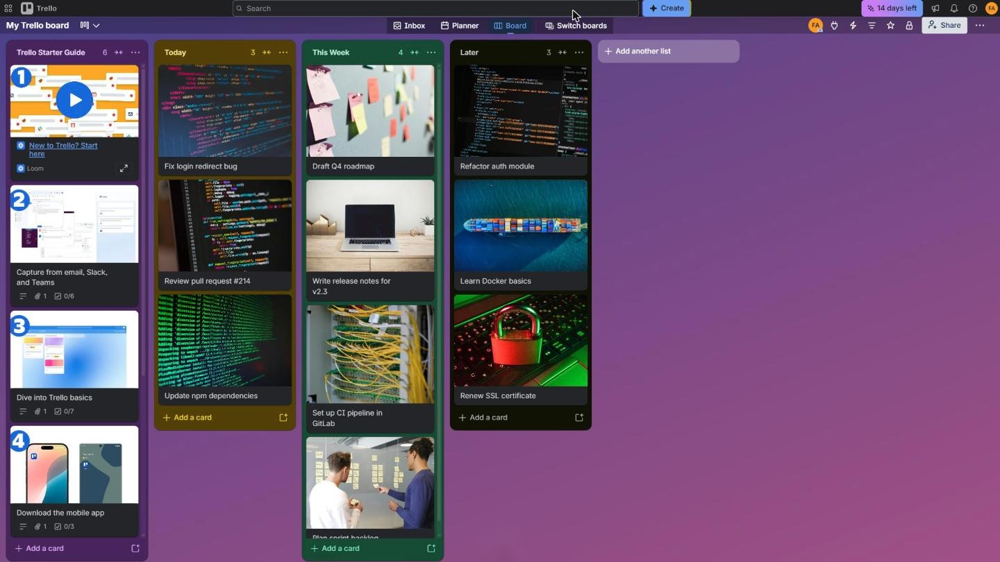
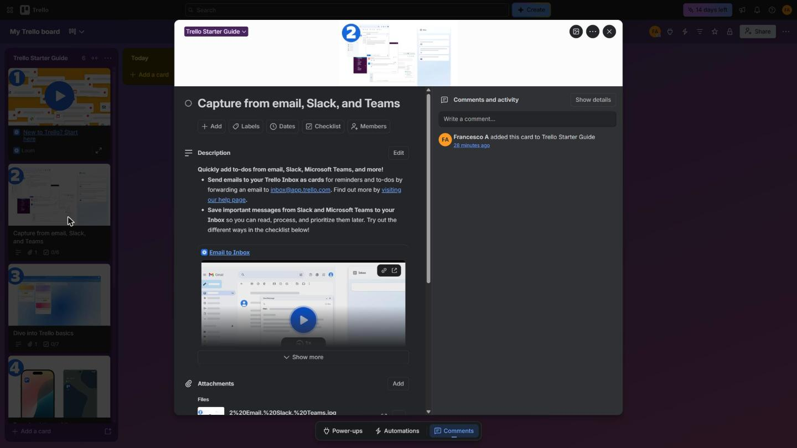
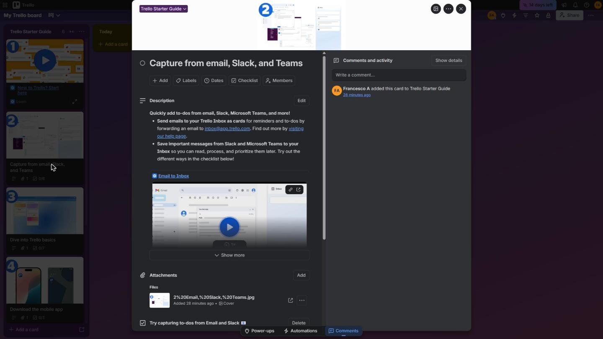

# Trello Compact Userstyle

A userstyle that gives Trello's board and card views back about 100px of vertical space on a 1080p screen, by trimming padding and moving the view switcher out of the content area.

| | Before | After |
|---|---|---|
| **Board** |  |  |
| **Card** |  |  |

## The problem

Trello's styling favours airy padding. It looks calm, but on a laptop it pushes work off-screen:

- The view switcher (Inbox / Planner / Board) floats over the bottom of the board, covering the last row of cards.
- The board header and global header carry padding that holds no content.
- The card modal is capped at the viewport height minus 128px and sits below a gap at the top, so long descriptions need scrolling sooner than necessary.
- The card's own nav strip (Power-ups / Automations / Comments) adds a footer bar below the card.

## What changed and why

| Change | Design reasoning |
|---|---|
| View switcher moved into the empty centre of the board header | That strip of the header is unused, so the switcher costs no space there and stops covering cards. |
| Header and board padding trimmed | Padding with no content inside it is spent space; the hierarchy still reads from type size and colour. |
| Card modal uses nearly the full viewport height | The card is the task in focus, so it gets the screen. |
| Card nav straddles the card's bottom edge | It stays visible and in reach without adding its own bar. |
| Card cover kept, at a 90px minimum | The cover is how people recognise a card, so it shrinks rather than disappearing. |

## Result

Measured at 1920×1080 from the screenshots above:

- **Board:** lists are about 108px taller (+12%), so more cards are visible before scrolling.
- **Card:** the scrollable content area is about 100px taller (+13%).
- No Trello features are hidden or disabled; only spacing and position change.

## Install

1. Install [Stylus](https://chromewebstore.google.com/detail/clngdbkpkpeebahjckkjfobafhncgmne) (Chrome, Edge) or [Stylus for Firefox](https://addons.mozilla.org/firefox/addon/styl-us/).
2. Open **[trello-compact.user.css](https://github.com/ai-autocoder/trello-compact-userstyle/raw/main/src/trello-compact.user.css)** and click **Install style**.

Stylus checks the same URL for updates, so new versions install automatically.

Other CSS-injection extensions (for example "User JavaScript and CSS") don't understand the `@-moz-document` block. With those, add a rule for `https://trello.com/*` and paste only the rules inside the block.

## Selector strategy

Trello's class names are hashed and change between deployments, so the stylesheet hooks onto things that stay put:

- **`id`s and `data-testid` attributes first**, e.g. `#island-nav` and `[data-testid="card-back-name"]`.
- **Short positional steps only beneath a stable anchor**, e.g. `[data-testid="card-back-name"] > div > div > div`.
- **One fully positional selector** (`#surface > div:nth-child(1)`), because the header wrapper has nothing else to hook onto. It is commented in the source.
- **`!important` only where Trello sets the value through a hashed class**, and each of those is commented.

## Limitations

- When Trello changes its markup, a selector can stop matching. The rule then simply does nothing, and that part of the page falls back to stock Trello.
- Tested in Chrome with Stylus on 1080p and laptop screens.

## Development

- Stylesheet: [`src/trello-compact.user.css`](src/trello-compact.user.css)
- Plain CSS with no nesting, for compatibility with userstyle managers.
- Issues and suggestions are welcome, especially for other screen densities.

## License

[MIT](LICENSE)
